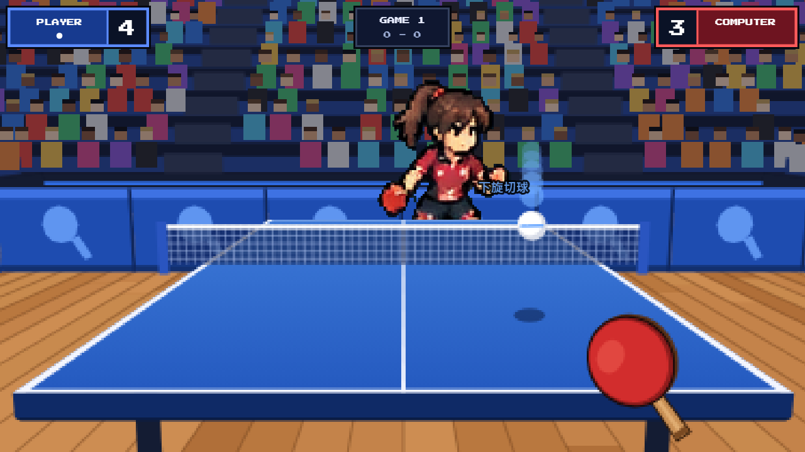

# 🏓 指尖桌球 Fingertip Pong

用手機就能玩的第一人稱像素風桌球。手指點在球的旁邊、往中間一滑，就能把球打回去。

**▶ 線上遊玩：<https://experiment502.github.io/ping-pong/>**



## 特色

- **第一人稱視角**：從球桌這一端看出去，對手在對面跟你對打。
- **滑動揮拍**：手指的位置就是球拍，從球的旁邊滑過球就會擊球。
- **旋轉球**：可以打出上旋拉球、下旋切球、側旋，對手也會。來球的旋轉會影響你該怎麼接。
- **多種球路**：對手會打平擊、吊高球、短球、擦邊球、擦網球，也會失誤。
- **練習模式**：直接比賽時從暫停選單、冠軍之路從 ☰ 選單進入，選一種球路讓對手一直送球給你練，會記錄成功數和連續成功紀錄。
- **🏆 冠軍之路（故事模式）**：從國小第一堂桌球課開始，在地圖上走動、找路人比賽、打敗老師和校長，再一路打到亞洲區比賽。球拍有耐久度，要記得修理。
- **擊球聲與觀眾**：擊球、落桌、擦網都有聲音，得分時觀眾會歡呼鼓掌，對打越久歡呼越大聲。
- **像素風場館**：有觀眾席、擋板、木地板，角色有待機、移動、正手、反手動畫。
- **主選單一步一步選**：
  1. 模式：直接比賽、冠軍之路
  2. 難度：簡單、普通、困難（冠軍之路會依難度調整所有對手的強度）
  3. 角色：男選手或女選手（直接比賽的對手會是另一位）
  4. 慣用手：右手、左手
  5. 直接比賽再選局數（1 局、三戰兩勝、五戰三勝、七戰四勝）
- **不用安裝**：一個網頁就能玩，手機、平板、電腦都可以。

## 怎麼玩

1. 對手的球**彈到你這邊的桌面之後**，手指按在球的旁邊，**往中間滑過球**。
2. 球打到左邊，就按螢幕左側往中間滑；打到右邊，就按右側往中間滑。
3. 只按著不動不會擊球，一定要滑動。

### 打出好球的訣竅

| 重點 | 說明 |
|---|---|
| 對準 | 讓拍子中心掃過球。會依準度顯示 **PERFECT**、**GOOD** 或 **OK**，越準落點越穩。 |
| 速度 | 滑得越快，球越快、落點越深。 |
| 方向 | 左右方向決定球往哪邊飛。往斜上方滑比較穩，完全橫著滑容易打到邊線附近。 |
| 時機 | 在球飛到手指附近的那一刻滑過去。 |

### 旋轉球

| 滑動方向 | 打出的球 | 殘影顏色 | 怎麼接 |
|---|---|---|---|
| 往上滑 | 上旋拉球：快、往下壓、落桌往前衝 | 橘紅 | 橫向平著打最穩，往上撈會出界 |
| 往下滑 | 下旋切球：慢、會飄、落桌後減速 | 藍 | 往上撈或往下切，平打容易掛網 |
| 橫著滑 | 帶側旋：空中往旁邊彎、落桌往旁邊跳 | 綠 | 瞄準時往反方向修正 |

### 規則

- 你打出的球要落在對手那半邊。掛網、落在自己這邊、出界都算失分。
- 球要先在你這邊彈一次才能打（發球除外），而且要在它第二次落下前打回去。
- 每局 11 分；打到 10:10 之後要領先 2 分才算贏。生涯模式跟一般路人比賽只打 5 分（4:4 之後要領先 2 分）。
- 比賽開始前先猜球：猜球在裁判的哪一隻手裡，猜對的人決定先發球或先接發球。
- 每 2 分換人發球，10:10 之後每 1 分換一次；每一局換人先發球。
- 發球時，球會自動往上拋，滑過球就能發出去。沒打到會重拋，不扣分。

### 冠軍之路（故事模式）

寶可夢式的玩法，現實生活的故事：

- 你是光明國小的學生。去學校的**桌球體育館**（教學樓一樓走廊盡頭）找陳教練，選第一支球拍（速度型、控制型、旋轉型），勁敵韓宇馬上就會來挑戰。
- 用**方向鍵**走路，**A 鍵**說話、調查，**☰** 開選單。頭上有桌球相框圖示的路人，按 A 可以找他比賽（也可以拒絕）；勁敵、主任、校長這些關鍵人物看到你會跳出「！」主動挑戰。贏了拿獎金，輸了要付錢。
- 打敗三位老師 → 訓導主任 → 校長，就能代表學校去市區中心的**市立體育館**，跟裡面的報名櫃檯報名：校際賽 → 地區比賽 → 全國比賽 → 亞洲區比賽。
- **球拍耐久度**：每一分都會磨損，歸零就壞掉；全部壞掉這場直接算輸，還會被送去商店。**恢復中心**和陳教練可以免費修理，商店賣比賽中能用的修理道具。
- 路線：自己家（二樓、一樓）→ 社區街道 → 社區公園 → 校門 → 操場 → 教學樓（一樓有辦公室和桌球體育館，二樓是教室）→ 市區道路 → 市區中心（市立體育館、恢復中心、商店）。社區街道上還有老奶奶家和勁敵家。之後的出國比賽會再加上國外的地圖。

### 練習模式

直接比賽時按上方中間的暫停，或在冠軍之路的地圖上按右上的 ☰，選「🎯 練習模式」，再選要練的球路（隨機、平擊、上旋拉球、下旋切球、側旋、短球、吊高球）。從直接比賽進入練習，那場比賽會結束；冠軍之路的練習用自己的球拍，但不會磨損。暫停後選「結束練習」，會回到原本進來的地方。對手會一直送球、不回擊，你的球落在對手那半邊就算成功。畫面上方會顯示成功數、連續成功數和最佳紀錄，下方會提示這種球該怎麼接。

主選單和暫停畫面都有「📖 遊戲說明」，裡面有完整的規則和技巧；旁邊的「🔊 音效」可以開關聲音。

## 在手機上玩

- 手機**直拿**就能玩，不用轉成橫向（橫拿也可以）。
- **Android（Chrome）**：按「開始比賽」後會自動全螢幕。
- **iPhone（Safari）**：按分享鍵，選「加入主畫面」，再從主畫面的圖示開啟，就不會有網址列。
- 要聽擊球聲，手機不要開靜音。

## 在電腦上執行

遊戲是純靜態網頁，不需要安裝套件或建置。在專案資料夾執行：

```bash
python -m http.server 8000
```

然後用瀏覽器打開 <http://localhost:8000>。也可以直接雙擊 `index.html` 開啟。在電腦上用滑鼠拖曳就能揮拍。

## 檔案結構

```
.
├── index.html               # 畫面版面、樣式、遊戲說明
├── js/
│   ├── game.js              # 比賽本體（畫面、物理、對手 AI、計分、音效）
│   ├── career.js            # 冠軍之路：存檔、球具與耐久度、賽事、商店
│   ├── world.js             # 冠軍之路的地圖：走路、建築、路人挑戰、對話
│   ├── maps.js              # 台灣篇 20 張地圖的資料（由 tools/build_maps.py 產生）
│   ├── chars.js             # 人物走路圖在 chars.png 裡的位置（由 tools/build_chars.py 產生）
│   └── maps_overseas.js     # 之後出國比賽用的 10 張地圖資料（還沒接進遊戲）
├── tools/
│   ├── build_maps.py        # 產生 js/maps.js：每張地圖的障礙物、門、出口、人物，並自動檢查走不走得到
│   ├── build_chars.py       # 把走路圖去背、對齊，產生 assets/chars.png 和 js/chars.js
│   └── upscale_maps.py      # 把地圖放大 3 倍並銳化，產生 assets/maps/hd/*.webp（遊戲讀這個）
├── assets/
│   ├── battle.png           # 對戰模式的對手（tools/build_chars.py --battle 產生）
│   ├── sprites.png          # 舊的對戰角色圖（目前沒用到，留著參考揮拍動作）
│   ├── referee.png          # 猜球用的裁判動畫圖
│   ├── male_portrait.png    # 男選手立繪
│   ├── female_portrait.png  # 女選手立繪
│   ├── maps/                # 冠軍之路 20 張地圖的背景圖（v2_ 開頭的是社區和學校）（hd/ 裡是遊戲用的高畫質版本）
│   ├── 15_character_sprite_sheets/  # 地圖上人物的走路圖原檔
│   └── chars.png            # 整理好的人物走路圖（由 tools/build_chars.py 產生）
└── docs/
    └── screenshot.png       # README 用的截圖
```

## 技術說明

- 使用 HTML5 Canvas 2D，沒有使用任何遊戲引擎或框架。
- 場景先畫在低解析度畫布上，再放大顯示，做出像素風格。
- 球的物理包含重力、旋轉造成的彎曲、落桌反彈、擦網、擦邊。
- 所有聲音（擊球、落桌、觀眾歡呼和掌聲）都用 Web Audio 即時合成，不需要音檔。
- 計分板字型使用 Google Fonts 的 [Press Start 2P](https://fonts.google.com/specimen/Press+Start+2P)，沒有網路時會改用一般字型。
- 網址加上 `?bot=1` 會進入自動對打的測試模式，用來檢查規則與計分。

## 更新網站

修改後推上 GitHub，GitHub Pages 約一分鐘後就會更新：

```bash
git add .
git commit -m "說明這次改了什麼"
git push
```
